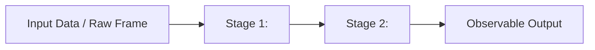

# Guide Mode Template and 3-Tier Calibration Reference

Use this reference when running `new::learning-diy` in `guide` mode. Draft `NN-<slug>.diy-guide.md` in Practical
Software
STE (using `new::docs` when active), matching the user's language and keeping solution code and inline formula leaks
out of milestone instructions unless the narrow exception gate in [SKILL.md](../SKILL.md) applies.
Follow [../../../references/session-contract.md](../../../references/session-contract.md) for `<session-dir>` paths,
host
capabilities, and host-specific link formats (`<session-link>` below).

---

## 1. Layout Rules Before Drafting

1. **Adaptive Primer Placement (Prevent Front-Loaded Theory Walls)**:
   - **0 to 2 concepts rated `Level 0`**: Place `Concept Primers` (for any Level 0 and Level 1 concepts) upfront in template Section 3 ("Concept Primers") before the roadmap.
   - **3 or more concepts rated `Level 0`**: Do not stack 100+ lines of theory before Milestone 1. Embed each primer directly inside the milestone that first uses it (**Just-In-Time Primers**), or move primers to **Appendix A** at the end and link each milestone explicitly (for example, `Read Primer A.3 before starting Milestone 3`). When template Section 3 ("Concept Primers") moves to Appendix A, renumber template Sections 4 through 6 sequentially.
2. **Single Primary Path Discipline**: When an architectural choice affects every subsequent milestone (such as REST versus WebSocket transport, or `SubViewportContainer` versus `ColorRect` in Godot), commit the roadmap steps to the user's chosen path (or one recommended default path). Document viable alternatives once in the milestone's `Design Choices and Alternatives` table instead of branching every later milestone across two setups.
3. **Skip `Level 2` Concepts in Primers**: Never write introductory primers for concepts rated `Level 2`.

---

## 2. Copy-Ready `NN-<slug>.diy-guide.md` Skeleton

Omit any section marked `<!-- Conditional: ... -->` when it adds no value for the task. When 3 or more concepts are
`Level 0`, adjust the placement of template Section 3 ("Concept Primers") using Section 1, Rule 1. In Korean guides,
write milestone titles and instructions in formal declarative style (`~한다`, and follow `new::docs` when active) instead
of imperative wording.

````markdown
# DIY Guide NN: <Task Title>

- **Task**: `NN` ([tasks.md](<session-link>/tasks.md))
- **Mode**: `guide`
- **Target Goal**: <1 to 2 sentences defining the concrete visual, functional, or behavioral target.>
- **Constraints / Environment**: <Language, engine, runtime, or API version.>
- **Primary Architecture Path**: <Chosen or recommended host/architecture used across the roadmap.>

## Before You Start
<!-- Conditional: include for multi-milestone guides so first-time readers orient quickly -->
- **Have ready**: <Tools, project template, or test fixture to open before Milestone 1.>
- **How to use this guide**: <1 sentence mapping primers to milestones and recommended pace per milestone.>

## 1. Calibrated Learning Profile

Record the diagnostic intake results so the user sees what depth each section uses and can request recalibration at any time.

| Concept | Level | Guide Depth Applied | Used In |
|---|---|---|---|
| `<Concept A>` | `Level 0` | Full primer (isolated example, *what*, *why needed*, *why this way*, derivation rule, resources) | Milestone 1 |
| `<Concept B>` | `Level 1` | Application bridge (*why needed here*, inputs, outputs, invariants) | Milestone 2 |
| `<Concept C>` | `Level 2` | Goal-only milestone bullet and edge-case reminders | Milestone 3 |

## 2. Big-Picture Mental Model

<1 short paragraph explaining the end-to-end data flow without spoiling implementation code.>



## 3. Concept Primers (Calibrated to Level 0 and Level 1 Only)

<!-- Include upfront ONLY when 0 to 2 concepts are Level 0. When 3 or more concepts are Level 0, move each primer inline into its milestone or into Appendix A at the end, link it from each milestone, and renumber template Sections 4 through 6 sequentially. Skip Level 2 concepts completely. -->

### <Level 0 Concept Name> (`Level 0`)

- **Why this task needs it**: <Connect the concept directly to the user's goal.>
- **Why it must work this way**: <Explain the mathematical, hardware, or architectural constraint and what breaks if done naively.>
- **Isolated conceptual example**:
  ```<lang>
  // Minimal toy example illustrating the concept outside the user's final code.
  ```
- **How each part works**:
  1. `<Line or expression 1>`: <Plain explanation.>
  2. `<Line or expression 2>`: <Plain explanation.>
- **Derivation rule or scaling bridge** *(when the toy example is smaller than the task target)*: <Explain the general rule that scales the toy example to the full task, such as deriving a 4x4 Bayer matrix from a 2x2 matrix.>
- **1-minute paper-and-pencil trace** *(optional for math or state transitions)*: <Prompt the user to trace 2 to 3 boundary values by hand before writing code.>
- **Related topics and learning resources**:
  - <Verified URL, canonical book chapter, or official docs title + exact search keywords.>

### <Level 1 Concept Name> (`Level 1`)

- **Why this task needs it**: <Explain how this familiar concept solves a specific requirement in the pipeline.>
- **How it connects here**: <State exact inputs, coordinate spaces, units, or invariants connecting adjacent stages.>

## 4. Phased Implementation Roadmap

Work through these milestones in order. Verify each observable checkpoint before moving to the next milestone.

### Milestone 1: <Imperative Milestone Title>

- **Required primer** *(when Appendix A holds the primers)*: Read `Primer A.1` before starting this milestone.
- **Objective**: <Concrete outcome of this milestone.>
- **Observable checkpoint**: <Exact visual, test, or runtime signal that confirms Milestone 1 works.>
- **Predict before running**: <Optional 1-sentence prediction prompt before the user tests.>
- **What to figure out**:
  <!-- Ask genuine questions. Never answer a question in parentheses or leak exact formulas. -->
  - <Guiding question 1 targeting inputs, coordinate spaces, or data layout.>
  - <Guiding question 2 targeting transformation or edge-case behavior.>
- **Why it works this way**: <Underlying principle without pasting solution code or step-by-step code recipes.>

#### Design Choices and Alternatives

| Approach | Trade-Offs | Best When |
|---|---|---|
| `<Option A>` | <Visual, performance, or complexity trade-off> | <Scenario> |
| `<Option B>` | <Visual, performance, or complexity trade-off> | <Scenario> |

#### Common Pitfalls and Debugging Signals

| Symptom Observed | Likely Cause | Diagnostic Question to Check |
|---|---|---|
| `<Broken output or error>` | `<Root mechanism without leaking the exact fix formula>` | `<Question pointing the user to verify the invariant>` |

#### Self-Check and Optional Experiment

- **Optional 1-minute experiment (Make-It-Break)**: <Small deliberate change to observe why a rule matters.>
- **Self-check questions**:
  1. <Question that the user can answer in their own words before advancing.>
  2. <Edge-case question to verify mental model.>

<details>
<summary>Check your reasoning (conceptual only, no code)</summary>

1. <Short conceptual check for Question 1 with zero solution code or exact task formulas.>
2. <Short conceptual check for Question 2.>

</details>

### Milestone 2: <Imperative Milestone Title>

<!-- Repeat Milestone structure, keeping depth strictly matched to the user's Level 0/1/2 profile. -->

## 5. Good to Know

- **<Engineering nuance 1>**: <Hardware quirk, precision limit, gamma/color space rule, or performance fact worth knowing.>
- **<Engineering nuance 2>**: <Adjacent best practice or portability trap.>

## 6. Further Learning and Stretch Challenges

### Stretch Challenges (Build After Finishing)
1. **<Challenge 1>**: <Concrete extension that pushes the concept further.>
2. **<Challenge 2>**: <Second extension combining another technique.>

### Related Topics to Explore Next
- **<Topic A>**: <1 sentence explaining how it builds on this task plus search keywords or verified reference.>
- **<Topic B>**: <1 sentence explaining how it builds on this task plus search keywords or verified reference.>

## Appendix A: Concept Primers
<!-- Conditional: include when 3 or more concepts are Level 0 and primers are deferred out of template Section 3 -->

### Primer A.1: <Level 0 Concept Name> (`Level 0`)
<!-- Reuse the template Section 3 Level 0 primer block format. -->
````

---

## 3. Worked 3-Tier Calibration Example (3D Retro Console Shader)

Use this side-by-side example to calibrate how much detail to write for the same topic (**Matrix Multiplication for Camera Projection** inside a post-processing or vertex shader for a 3D retro console):

### If the User Rated Matrix Multiplication as `Level 0` (Unfamiliar)

- **Provide an isolated conceptual snippet**: Show a 2D rotation or 3D scaling matrix multiplying a single vector (`vec3` or `vec4`) in a toy snippet (not the user's exact full MVP camera pipeline).
- **Explain the snippet**: Walk through row-by-column dot products, why 3D points use a 4th component (`w = 1.0` for positions versus `w = 0.0` for directions), and how `M * v` transforms a vector from one coordinate space to another.
- **Explain why the task needs it**: Explain that reconstructing world or view positions from a depth buffer (or snapping 3D vertices to a low-precision grid for PS1-style jitter) requires converting coordinates between clip space, view space, and world space.
- **Explain why it must be done that way**: Explain why multiplication order matters (`Projection * View * Model * pos` is non-commutative) and why homogeneous coordinates combine translation, rotation, and projection in one 4x4 matrix multiplication.
- **Teach scaling and trace**: Prompt the user to multiply one concrete 2D point `(1, 0)` by a 90-degree rotation matrix on paper before generalizing to 4x4 camera transforms.
- **Provide related topics and resources**: List homogeneous coordinates, column-major versus row-major layout, affine versus perspective-correct interpolation, and verified tutorials (such as *LearnOpenGL* "Coordinate Systems" and *3Blue1Brown* "Essence of Linear Algebra" Chapter 3 and 4).

### If the User Rated Matrix Multiplication as `Level 1` (Knows Math, Not Why Needed Here)

- Omit definitions of vector-matrix dot products and basic code snippets.
- Explain **why this shader needs it**: To achieve PS1-style vertex snapping (or reconstruct view-space depth for distance fog in a post-processing pass), you must move points into clip space or view space before quantizing coordinates, then divide by `w` (perspective divide) to reach Normalized Device Coordinates (NDC).
- State the contract: Input depth in `[0, 1]` plus inverse projection matrix yields view-space position after dividing by `w`. Watch for your engine's NDC depth range (`[-1, 1]` in OpenGL versus `[0, 1]` in Vulkan/DirectX/WebGPU).

### If the User Rated Matrix Multiplication as `Level 2` (Comfortable)

- Write only the concrete milestone bullet: "Reconstruct view-space position from screen UV and sampled depth using the inverse projection matrix, accounting for your backend's NDC depth range (`[0, 1]` or `[-1, 1]`)."

---

## 4. Verification, Spoiler Hygiene, and Citation Rules

1. **Make every milestone visually or programmatically verifiable**: Pair each milestone with a concrete intermediate output (for example, rendering raw quantized channel values before adding dithering, or printing intermediate transformed values for one known test input).
2. **Verify and link real URLs**: When web search confirms an official documentation page or canonical tutorial URL,
   emit it as a clickable Markdown link (`[Title](https://...)`) rather than plain domain text. Never fabricate URLs.
   When web search is unavailable or a URL cannot be verified, fall back to stable entry points:
   - Official documentation names and exact page headings (for example, "MDN Web Docs: WebGL2 `texImage2D`").
   - Canonical books and chapter titles (for example, *Real-Time Rendering*, 4th Edition, Chapter 5).
   - Exact search keywords (for example, search terms: `ordered dithering Bayer matrix GLSL`).
3. **Avoid solution leakage in every form**: Never hide complete task implementations inside "hint" blocks, 1-to-1 pseudocode, inline prose expressions (`floor(UV / TEXTURE_PIXEL_SIZE)`), or parenthetical hints that answer your own guiding question. In Level 0 math tables and paper traces, use generic variables (`u`, `texel_width`, `steps`) rather than engine built-ins (`UV`, `TEXTURE_PIXEL_SIZE`) when the user must map math onto engine APIs in that milestone.
4. **Verify language syntax before citing constructs**: Check exact syntax against official docs or web search before
   writing language-specific type or declaration forms. When unverified, describe the concept syntax-neutrally.
5. **Run a pre-delivery STE scan**: Before presenting `NN-<slug>.diy-guide.md`, scan the document (against `new::docs`
   when active) to strip AI filler modifiers (`seamlessly`, `simply`, `robust`), contractions, semicolons, and
   clause-joining em-dashes.
