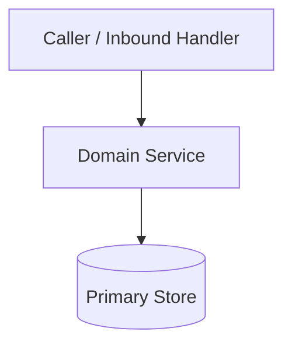

# Session Document Templates (`tasks.md`, `NN-<slug>.plan.md`, `NN-<slug>.report.md`)

Use these templates when `my-working-task` triggers session documents. Apply Practical Software STE (`my-writing-docs`):
active voice, conditions before commands, concrete bounds, consistent language across all documents for a task, and zero
AI filler. Follow [../../../references/session-contract.md](../../../references/session-contract.md) and the active host
adapter in [../../../harnesses/README.md](../../../harnesses/README.md) for `<session-dir>` paths and host-specific link
formats (`<session-link>` and `<file-link>` below). In Korean session documents, use formal declarative titles and steps
(`~한다`) instead of imperative wording (see `references/korean-style-guide.md` in `my-writing-docs`).

---

## 1. `tasks.md` Template (Unified Session Hub and Live Checklist)

Keep `tasks.md` as the single mutable state file across all tasks in a conversation. Use standard GFM `- [ ]` and `- [x]` checkboxes, mark at most one active item with `**(in progress)**`, and keep Markdown links in the Overview Table and inside `<details>` bodies (never inside `<summary>`).

````markdown
# Session Tasks

| # | Status | Task | Docs |
|---|---|---|---|
| 01 | Done | <Audit or Review Task Title> | - \| [report](<session-link>/01-audit-slug.report.md) |
| 02 | Done | <Completed Implementation Title> | [plan](<session-link>/02-impl-slug.plan.md) \| [report](<session-link>/02-impl-slug.report.md) |
| 03 | In Progress (Step 1/3) | <Active Task Title> | [plan](<session-link>/03-active-slug.plan.md) \| - |

---

<details>
<summary>[x] Task 01 - Audit or Review Task Title</summary>

- **Docs**: [report](<session-link>/01-audit-slug.report.md)
- **Summary**: <One-sentence outcome of the completed audit or review.>

- [x] <Top-level completed step 1>
- [x] <Top-level completed step 2>

</details>

<details>
<summary>[x] Task 02 - Completed Implementation Title</summary>

- **Docs**: [plan](<session-link>/02-impl-slug.plan.md) | [report](<session-link>/02-impl-slug.report.md)
- **Summary**: <One-sentence outcome of the completed implementation.>

- [x] Step 1: <Completed step title>
- [x] Step 2: <Completed step title>

</details>

---

## Task 03 - <Active Task Title>

- **Status**: In Progress (Step 1/3)
- **Docs**: [plan](<session-link>/03-active-slug.plan.md) | report (pending)
- **Summary**: <One-sentence description of what this task delivers.>

### Step 1: <Imperative Step Title>
<One sentence stating what works or exists when Step 1 finishes.>

- [x] <Completed action naming exact file and symbol>
- [ ] **(in progress)** <Active action naming exact file and symbol>
- [ ] <Verification check or test command for Step 1>

### Step 2: <Imperative Step Title>
<One sentence stating what works or exists when Step 2 finishes.>

- [ ] <Bounded implementation action>
- [ ] <Targeted test command for Step 2>

### Step 3: Verify and write completion report
<All verification checks pass, Task 03 closes in tasks.md, and 03-active-slug.report.md records outcomes and follow-ups.>

- [ ] Run full targeted verification suite (`<command>`).
- [ ] Write `03-active-slug.report.md`, mark all items `- [x]`, and collapse Task 03 in `tasks.md`.
````

---

## 2. `NN-<slug>.plan.md` Template (Structured Immutable Technical Plan)

Use monotonic `H1 -> H2 -> H3 -> H4` headings with one `H1` per plan. Include every section marked `<!-- Required -->` in every plan. Include sections marked `<!-- Conditional: ... -->` only when the task touches those concerns so compact plans stay between 40 and 90 lines. Never modify `NN-<slug>.plan.md` to track execution progress, and never place delivery checklists inside the plan.

````markdown
# Plan NN: <Short Task Title>

- **Task**: `NN` ([tasks.md](<session-link>/tasks.md))
- **Target**: `<repo>` @ `<branch>` (`<short-sha>`)
- **Follows**: [01-<prev-slug>.report.md](<session-link>
  /01-prev-slug.report.md) <!-- Conditional: omit when standalone -->

## Requirements

### Overview & Goals
<!-- Required -->
<2 to 3 sentences stating the problem, what the current codebase does today, and what this change achieves.>

Expected outcomes:
- <Concrete, measurable outcome 1>
- <Concrete, measurable outcome 2>
- <Concrete, measurable outcome 3>

### Scope
<!-- Required -->

#### In Scope
- <Specific package, handler, model, or workflow modified in this task>
- <Specific persistence, API, or test suite included in this task>

#### Out of Scope
- <Adjacent feature, protocol version, or broad refactor explicitly excluded from this task>
- <Unrelated cleanup deferred to a separate task>

### Open Questions & Assumptions
<!-- Conditional: include when ambiguities or risky trade-offs need user confirmation before approval -->
1. **<Decision Topic>**: Recommend `<Option A>`. Confirm before execution if `<Option B>` is preferred.
2. **Assumption**: <Explicit constraint assumed unless the user overrides it.>

### User Stories
<!-- Conditional: include only when user-facing behavior or operator workflows change -->
- **As a <role>**, I want <capability>, so that <concrete benefit>.

### Functional Requirements
<!-- Conditional for compact localized fixes. Required for multi-component features. -->
1. **<Requirement Name>**: <Deterministic rule, state transition, or invariant.>
2. **<Requirement Name>**: <Deterministic rule, state transition, or invariant.>

### Non-Functional Requirements
<!-- Conditional: include when latency, throughput, concurrency, compatibility, or size bounds apply -->
- **<Latency / Throughput / Size>**: <Exact bound, such as p99 under 20ms or payload under 1MB.>
- **<Concurrency / Compatibility / Observability>**: <Locking, backward-compatibility, or metric requirement.>

## Technical Design

### Current Implementation
<!-- Required: cite exact file:line facts -->
- **<Subsystem Name> (`path/to/file.ext:line`)**: <What exists today, including relevant callers, stubs, or bottlenecks.>
- **<Subsystem Name> (`path/to/other.ext:line`)**: <Existing data model, transaction boundary, or handler behavior.>

### Key Decisions
<!-- Required -->
1. **<Decision Summary>**: <Chosen approach and 1 to 2 sentences explaining why it fits existing architecture.>
2. **<Decision Summary>**: <Chosen approach and trade-off rationale.>

### Proposed Changes
<!-- Required -->
1. **<Area 1> (`package/path`)**: <High-level summary of structural or behavioral changes.>
2. **<Area 2> (`package/path`)**: <High-level summary of structural or behavioral changes.>

### Data Models / Contracts
<!-- Conditional: show concise type definitions, interfaces, schemas, or SQL signatures only. Omit long function bodies. -->
```go
type ExampleInput struct {
    ID string
}
```

### Components
<!-- Conditional: include when 2 or more components change -->
| Component | Package / Path | Responsibility |
|---|---|---|
| `<ComponentName>` | `path/to/pkg` | <Single-sentence responsibility> |

### File Structure
<!-- Required -->
```text
dir/
  subpkg/
    existing_file.go          (modified: <concise reason>)
    new_feature.go            (added: <concise reason>)
    new_feature_test.go       (added: <concise reason>)
```

### Architecture Diagram
<!-- Conditional: include when 3 or more components, queues, or databases interact. Quote labels with parentheses or brackets. -->


### Risks
<!-- Conditional: include when runtime, data, migration, or compatibility risks exist -->
| Risk | Impact | Mitigation |
|---|---|---|
| <Specific failure mode or race condition> | <Concrete impact> | <Exact transaction, timeout, feature flag, or fallback> |

## API Reference
<!-- Conditional: include only when HTTP routes, RPC methods, CLI flags, events, or webhooks change -->

### <Endpoint or Trigger Matrix>
<Request/response payloads, status codes, or state transition matrix table.>

## Migration Plan
<!-- Conditional: include only when database schemas, configuration flags, or multi-node rollouts change -->

### Additive Schema or Configuration Changes
<SQL DDL or configuration keys.>

### Rollout & Rollback
1. **Rollout**: <Ordered deployment steps.>
2. **Rollback**: <Runtime kill-switch or binary revert steps completing in under 1 minute.>

## Alternatives Considered
<!-- Conditional: include only when multiple viable designs were weighed -->

| Criterion | Chosen: <Option A> | Alternative: <Option B> |
|---|---|---|
| <Latency / Footprint / Durability> | <Fact> | <Fact> |

### Why <Option A> Won
- <1 to 2 concrete reasons tied to codebase constraints.>

## Testing

### Validation Approach
<!-- Required -->
1. **<Build / Static Check>**: Run `<exact command>`.
2. **<Unit / Integration Suite>**: Run `<exact command>`.

### Key Scenarios
<!-- Required -->
- **<Scenario Name>**: <Input, action, and asserted state.>

### Edge Cases
<!-- Conditional -->
- **<Edge Case Name>**: <Boundary input, race, timeout, or invalid state and asserted behavior.>

### Test Changes
<!-- Required -->
- **Added / Updated**: `path/to/file_test.ext` covering <scenarios>. (Or state `None` with reason when no tests change.)
````

---

## 3. `NN-<slug>.report.md` Template - Mode A: Implementation Report

Use Mode A at the end of every planned, multi-step, architectural, or escalated implementation task. Move all out-of-scope follow-ups and mid-session discoveries into `## Follow-Up & Future Work` with stable IDs (`F1`, `F2`, ...) instead of printing them in chat.

````markdown
# Report NN: <Short Task Title>

- **Task**: `NN` ([tasks.md](<session-link>/tasks.md))
- **Outcome**: `Completed` <!-- Or: Partial | Blocked -->
- **Target**: `<repo>` @ `<branch>` (`<base-sha> -> <head-sha or uncommitted>`)
- **Plan**: [NN-<slug>.plan.md](<session-link>/NN-slug.plan.md) <!-- Omit when no plan existed -->

## Summary & Outcome

<2 to 4 sentences stating the requested goal, final completion state, and scope adherence.>

## Actions Completed

- **<Component or Area>**: <What changed and why in 1 to 2 sentences.>
- **<Component or Area>**: <What changed and why in 1 to 2 sentences.>

### Files Changed
<!-- When <= 15 files changed: list every file individually. -->
<!-- When > 15 files changed: include diff stat (`N files changed, +X / -Y`), group bulk repetitive directories with counts (for example, `internal/domain/model/ (76 files)`), and still list key architectural files individually. -->
Diff stat: `<N files changed, +X / -Y>` *(include when > 15 files changed)*

| File / Directory | Action | Summary |
|---|---|---|
| [file_a.ext](<file-link>/file_a.ext) | Modified | <Concise change description> |
| [file_b.ext](<file-link>/file_b.ext) | Added | <Concise change description> |
| `path/to/bulk_dir/` (24 files) | Modified | <Grouped repetitive change summary> |

### Plan Deviations
<!-- Conditional: omit if execution matched NN-<slug>.plan.md without changes -->
- <State any adjustment made during implementation and the concrete reason.>

## Verification & How to Run

| Check | Command | Result | Notes |
|---|---|---|---|
| Build | `<build command>` | `PASS` | Zero compile errors |
| Unit Tests | `<test command>` | `PASS` | `42 passed`, `3 SKIPPED` (`<env guard>`) |
| Static Analysis | `<lint command>` | `PASS` | Zero errors |

- **Try**: `<exact command, URL, or entry point for manual inspection>`
- **Unverified / Limitations**: <State skipped tests, unexercised live integrations, or deferred checks. Omit if everything ran end to end.>

## Operational Notes & Rollback
<!-- Conditional: include only when DDL prerequisites, env flags, rollout ordering, or rollback steps apply -->
- **Prerequisite**: <Required migration or configuration flag before enabling.>
- **Rollback**: <Exact revert command or kill switch.>

## Follow-Up & Future Work

<!-- Record items deferred via Out of Scope or noticed mid-session. If none exist, write: "No follow-up items identified." -->

| ID | Priority | Location | Follow-Up Action |
|---|---|---|---|
| `F1` | `MUST` | [file.ext](<file-link>/file.ext#L10-L25) | <Critical bug, security gap, or required migration for a dedicated task> |
| `F2` | `SHOULD` | [other.ext](<file-link>/other.ext#L40) | <Recommended test, doc update, or cleanup outside this task's scope> |
| `F3` | `COULD` | [opt.ext](<file-link>/opt.ext) | <Optional ergonomic or performance improvement> |
````

---

## 4. `NN-<slug>.report.md` Template - Mode B: Audit / Investigation Report

Use Mode B for extended read-only code reviews, migration audits, security reviews, and deep root-cause investigations so findings carry stable severity IDs (`C1`, `H1`, `M1`, `L1`) that subsequent implementation tasks can reference directly.

````markdown
# Report NN: <Short Audit or Investigation Title>

- **Task**: `NN` ([tasks.md](<session-link>/tasks.md))
- **Outcome**: `Audit Complete` <!-- Or: Root Cause Confirmed | Investigation Blocked -->
- **Target**: `<repo>` @ `<branch>` (`<short-sha>`)
- **Plan**: [NN-<slug>.plan.md](<session-link>/NN-slug.plan.md) <!-- Conditional: omit when no plan existed -->

## Summary & Verdict

<2 to 4 sentences stating what was audited, overall readiness or root-cause verdict, and total findings by severity.>

## Scope & Verification Matrix

| Check / Spec | Status | Observed Result |
|---|---|---|
| `<build or test command>` | `PASS` / `FAIL` | <Concrete output or failing package count> |
| [spec.md](<file-link>/spec.md) | `PASS` / `PARTIAL` / `FAIL` | <Concise compliance summary> |

## Findings

### Critical
- **`C1` - <Short Issue Title>** ([file.ext](<file-link>/file.ext#L10-L25)): <Confirmed defect, concrete failure impact, and recommended fix.>

### High
- **`H1` - <Short Issue Title>** ([other.ext](<file-link>/other.ext#L40)): <Confirmed defect, concrete impact, and recommended fix.>

### Medium
- **`M1` - <Short Issue Title>** ([third.ext](<file-link>/third.ext#L80)): <Confirmed gap and recommended fix.>

### Low
- **`L1` - <Short Issue Title>** ([fourth.ext](<file-link>/fourth.ext#L12)): <Minor cleanup or doc gap.>

## Recommended Next Tasks

| ID | Priority | Location | Follow-Up Action |
|---|---|---|---|
| `C1` | `MUST` | [file.ext](<file-link>/file.ext#L10-L25) | <Concrete remediation action for the next task> |
| `H1` | `SHOULD` | [other.ext](<file-link>/other.ext#L40) | <Concrete remediation action> |
| `L1` | `COULD` | [fourth.ext](<file-link>/fourth.ext#L12) | <Optional follow-up cleanup> |
````

---

## 5. Minimal Chat Handoffs (Mode 1)

Never paste `NN-<slug>.plan.md` or `NN-<slug>.report.md` sections into the chat reply. Use 1 to 2 sentences with clickable file links:

- **Plan approval handoff (`/plan`)**:
  ```markdown
  Review [01-feature-slug.plan.md](<session-link>/01-feature-slug.plan.md) and [tasks.md](<session-link>/tasks.md).
  Next: reply with approval (per the active host adapter) to start Step 1, or share adjustments.
  ```
- **Session completion handoff (`NN-<slug>.report.md`)**:
  ```markdown
  Completed <short outcome>. Read [01-feature-slug.report.md](<session-link>/01-feature-slug.report.md) for actions taken, verification results, and follow-up work.
  ```
