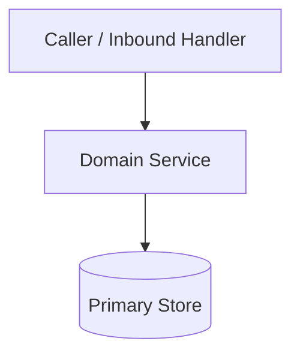

# Session Document Templates (`plan.md`, `todo.md`, `report.md`)

Use these templates when `my-working-task` triggers session documents. Apply Practical Software STE (`my-writing-docs`): active voice, conditions before commands, concrete bounds, and zero AI filler.

---

## 1. `plan.md` Template (Junie-Style Technical Plan)

Include `# Requirements`, `# Technical Design`, and `# Testing` in every plan. Include conditional sections (`User Stories`, `Architecture Diagram`, `# API Reference`, `# Migration Plan`, `# Alternatives Considered`) only when the task touches those concerns. Never put delivery steps inside `plan.md` because step tracking belongs in `todo.md`.

```markdown
# Requirements

### Overview & Goals
<2 to 3 sentences stating the problem, what the current codebase does today, and what this change achieves.>

Expected outcomes:
- <Concrete, measurable outcome 1>
- <Concrete, measurable outcome 2>
- <Concrete, measurable outcome 3>

### Scope

#### In Scope
- <Specific package, handler, model, or workflow modified in this session>
- <Specific persistence, API, or test suite included in this session>

#### Out of Scope
- <Adjacent feature, protocol version, or broad refactor explicitly excluded from this session>
- <Unrelated cleanup deferred to a separate session>

### User Stories
<!-- Conditional: include only when user-facing behavior or operator workflows change -->
- **As a <role>**, I want <capability>, so that <concrete benefit>.

### Functional Requirements
1. **<Requirement Name>**: <Deterministic rule, state transition, or invariant.>
2. **<Requirement Name>**: <Deterministic rule, state transition, or invariant.>

### Non-Functional Requirements
- **<Latency / Throughput / Size>**: <Exact bound, such as p99 under 20ms or payload under 1MB.>
- **<Concurrency / Compatibility / Observability>**: <Locking, backward-compatibility, or metric requirement.>

# Technical Design

### Current Implementation
- **<Subsystem Name> (`path/to/file.ext:line`)**: <What exists today, including relevant callers, stubs, or bottlenecks.>
- **<Subsystem Name> (`path/to/other.ext:line`)**: <Existing data model, transaction boundary, or handler behavior.>

### Key Decisions
1. **<Decision Summary>**: <Chosen approach and 1 to 2 sentences explaining why it fits existing architecture.>
2. **<Decision Summary>**: <Chosen approach and trade-off rationale.>

### Proposed Changes
1. **<Area 1> (`package/path`)**: <High-level summary of structural or behavioral changes.>
2. **<Area 2> (`package/path`)**: <High-level summary of structural or behavioral changes.>

### Data Models / Contracts
<!-- Show concise type definitions, interfaces, schemas, or SQL signatures only. Omit full function bodies. -->
```go
type ExampleInput struct {
    ID string
}
```

### Components
| Component | Package / Path | Responsibility |
|---|---|---|
| `<ComponentName>` | `path/to/pkg` | <Single-sentence responsibility> |

### File Structure
```text
dir/
  subpkg/
    existing_file.go          (modified: <concise reason>)
    new_feature.go            (added: <concise reason>)
    new_feature_test.go       (added: <concise reason>)
```

### Architecture Diagram
<!-- Conditional: include when 3 or more components, queues, or databases interact. Quote labels with parentheses or brackets. -->


### Risks
| Risk | Impact | Mitigation |
|---|---|---|
| <Specific failure mode or race condition> | <Concrete impact> | <Exact transaction, timeout, feature flag, or fallback> |

# API Reference
<!-- Conditional: include only when HTTP routes, RPC methods, CLI flags, events, or webhooks change -->

### <Endpoint or Trigger Matrix>
<Request/response payloads, status codes, or state transition matrix table.>

# Migration Plan
<!-- Conditional: include only when database schemas, config flags, or multi-node rollouts change -->

### Additive Schema or Config Changes
<SQL DDL or configuration keys.>

### Rollout & Rollback
1. **Rollout**: <Ordered deployment steps.>
2. **Rollback**: <Runtime kill-switch or binary revert steps completing in under 1 minute.>

# Alternatives Considered
<!-- Conditional: include only when multiple viable designs were weighed -->

| Criterion | Chosen: <Option A> | Alternative: <Option B> |
|---|---|---|
| <Latency / Footprint / Durability> | <Fact> | <Fact> |

#### Why <Option A> Won
- <1 to 2 concrete reasons tied to codebase constraints.>

# Testing

### Validation Approach
1. **<Build / Static Check>**: Run `<exact command>`.
2. **<Unit / Integration Suite>**: Run `<exact command>`.

### Key Scenarios
- **<Scenario Name>**: <Input, action, and asserted state.>

### Edge Cases
- **<Edge Case Name>**: <Boundary input, race, timeout, or invalid state and asserted behavior.>

### Test Changes
- **Added / Updated**: `path/to/file_test.ext` covering <scenarios>.
```

---

## 2. `todo.md` Template (Standalone Checkbox Tracker)

Use standard `- [ ]` and `- [x]` checkboxes so GitHub, JetBrains IDE Markdown preview, and Antigravity all render native checkboxes. Mark at most one active item with `**(in progress)**` while keeping `- [ ]` intact.

```markdown
# Todo: <Short Task Title>

**Plan**: [plan.md](file:///absolute/path/to/plan.md)
**Status**: In progress (Step 1 of 3)

### Step 1: <Imperative Step Title>
<One sentence stating what works or exists when Step 1 finishes.>

- [x] <Completed action naming exact file and symbol>
- [ ] **(in progress)** <Active action naming exact file and symbol>
- [ ] <Verification test or check command for Step 1>

### Step 2: <Imperative Step Title>
<One sentence stating what works or exists when Step 2 finishes.>

- [ ] <Bounded implementation action>
- [ ] <Targeted test command for Step 2>

### Step 3: <Verify and write completion report>
<All checks pass and report.md records outcomes and follow-up items.>

- [ ] Run full targeted verification suite (`<command>`).
- [ ] Mark all completed steps `- [x]` and generate `report.md`.
```

---

## 3. `report.md` Template (Session Completion Report)

Write `report.md` at the end of every planned, multi-step, architectural, or time-intensive session. Move all follow-up observations and deferred `Out of Scope` items into `# Follow-Up & Future Work` instead of printing them in chat.

```markdown
# Summary & Outcome

<2 to 4 sentences stating the requested goal, final completion state, scope adherence, and links to [plan.md](file:///absolute/path/to/plan.md) and [todo.md](file:///absolute/path/to/todo.md) when present.>

# Actions Completed

- **<Component or Area>**: <What changed and why in 1 to 2 sentences.>
- **<Component or Area>**: <What changed and why in 1 to 2 sentences.>

### Files Changed
| File | Action | Summary |
|---|---|---|
| [file_a.ext](file:///absolute/path/to/file_a.ext) | Modified | <Concise change description> |
| [file_b.ext](file:///absolute/path/to/file_b.ext) | Added | <Concise change description> |

### Plan Deviations
<!-- Omit if execution matched plan.md without changes -->
- <State any adjustment made during implementation and the concrete reason.>

# Verification & How to Run

1. **<Check Name>**: Ran `<exact command>` -> <concrete pass count or output>.
2. **<Check Name>**: Ran `<exact command>` -> <concrete pass count or output>.

**Try**: `<exact command, URL, or entry point for manual inspection>`

# Follow-Up & Future Work

<!-- Record items deferred via Out of Scope or noticed mid-session. If none exist, write: "No follow-up items identified." -->
| Priority | Location | Follow-Up Action |
|---|---|---|
| `MUST` | `path/to/file.ext:line` | <Critical bug, security gap, or required migration for a dedicated session> |
| `SHOULD` | `path/to/file.ext:line` | <Recommended test, doc update, or cleanup outside this session's scope> |
| `COULD` | `path/to/file.ext:line` | <Optional ergonomic or performance improvement> |
```

---

## 4. Minimal Chat Handoffs (Mode 1)

Never paste `plan.md` or `report.md` sections into the chat reply. Use 1 to 2 sentences with clickable file links:

- **Plan approval handoff (`/plan`)**:
  ```markdown
  Review [plan.md](file:///absolute/path/to/plan.md) and [todo.md](file:///absolute/path/to/todo.md).
  Next: click Proceed (or reply with adjustments) to start Step 1.
  ```
- **Session completion handoff (`report.md`)**:
  ```markdown
  Completed <short outcome>. Read [report.md](file:///absolute/path/to/report.md) for actions taken, verification results, and follow-up work.
  ```
